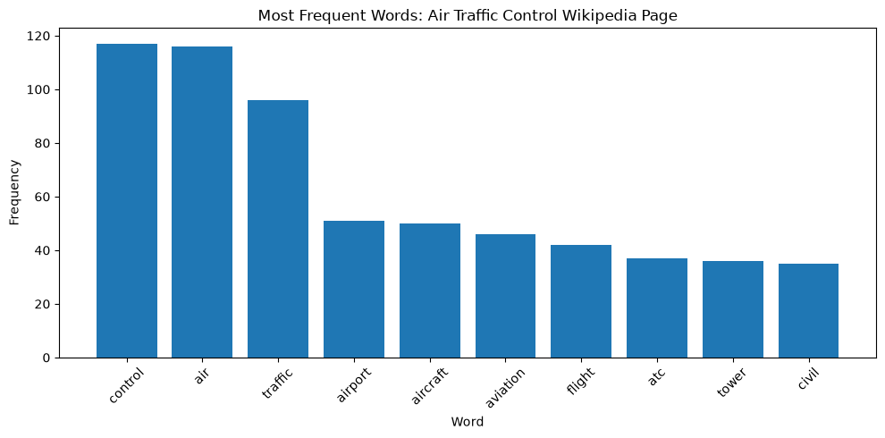
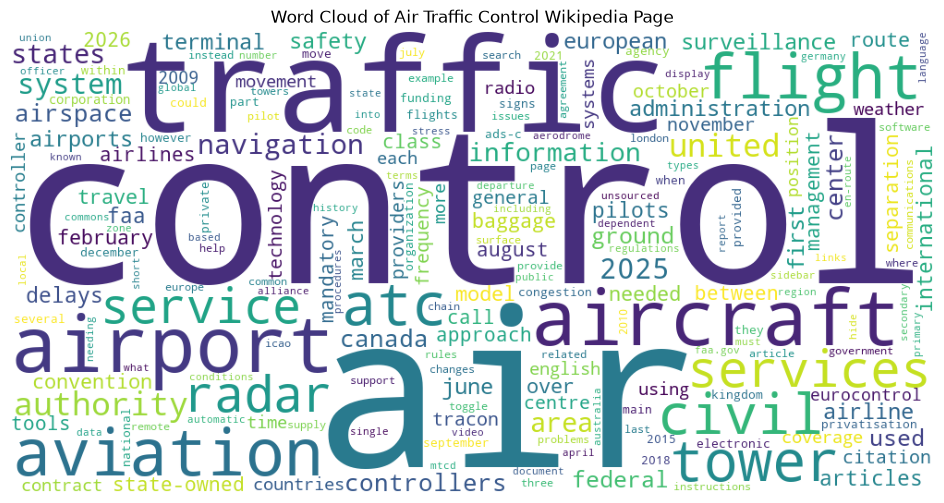

# nlp-01-getting-started
[](https://github.com/KHenn22/nlp-01-getting-started/blob/main/pyproject.toml)
[](https://github.com/KHenn22/nlp-01-getting-started/actions/workflows/ci-python-zensical.yml)
[](https://khenn22.github.io/nlp-01-getting-started/)
[](https://docs.astral.sh/uv/)
[](https://docs.astral.sh/ty/)
[](https://zensical.org/)
[](https://github.com/KHenn22/nlp-01-getting-started/blob/main/LICENSE)
> Retrieve, clean, and analyze the Wikipedia article on Air traffic control using Python.
## Project Overview
Author: Kevin Hennelly (KHenn22), adapted from an example by Denise Case
Date: 2026 October
Course: Web Mining and Applied NLP, Project 01
This project adapts the Web Mining and Applied NLP example
to analyze the Wikipedia article on Air traffic control.
It retrieves the page, cleans the text, counts word frequencies,
and visualizes the results.
**Question:** What are the core concepts of air traffic control
once filler words and Wikipedia page text are removed?
The project is configured in [pyproject.toml](pyproject.toml).
## Data
The script retrieves the Wikipedia article on
[Air traffic control](https://en.wikipedia.org/wiki/Air_traffic_control)
each time it runs, using the Requests library.
No local input dataset is required.
Wikipedia text is available under the
[CC BY-SA 4.0](https://creativecommons.org/licenses/by-sa/4.0/) license.
## Approach
The project uses the techniques from the example:
- Retrieving HTML using HTTP requests.
- Parsing HTML and extracting text with BeautifulSoup.
- Cleaning and normalizing text with list comprehensions.
- Counting word frequencies using Polars.
- Visualizing frequent words using Matplotlib.
- Creating word clouds to explore vocabulary patterns.
Custom changes made for this project:
- Analyzes the Air traffic control article instead of the NLP article.
- Strips punctuation **before** checking word length,
  so short words are filtered consistently.
- Removes a custom list of filler words (that, with, from)
  and Wikipedia citation text (retrieved, archived, edit).
- Keeps important 3-letter aviation terms (air, atc, faa).
- Uses topic-specific chart titles and saves both charts
  to `docs/images/` for the documentation site.
Explore these important project components:
- [pyproject.toml](pyproject.toml) - project identity, dependencies, and tool configuration.
- [src/nlp/web_words.py](src/nlp/web_words.py) - executable Python analysis.
- [notebooks/web_words.ipynb](notebooks/web_words.ipynb) - interactive Jupyter notebook example.
- [tests/](tests) - automated tests.
- [.github/workflows/](.github/workflows) - automated testing and documentation deployment.
- [docs/](docs) - project documentation.
- [zensical.toml](zensical.toml) - documentation configuration.
## Run the Project
Follow the [Professional Python Workflow Guide](https://denisecase.github.io/pro-analytics-02/)
to set up your machine and project environment.
From a VS Code terminal in the project root:
```shell
uv run python -m nlp.web_words
```
Close each chart window after viewing
so the script can continue executing.
The charts are also saved to `docs/images/`.
## Results
Successful execution ends with:
```text
========================
Pipeline executed successfully!
========================
```
A `project.log` file is created in the project root.
After cleaning, 4,207 words remained. The ten most frequent words:
| Word | Count |
| --- | --- |
| control | 117 |
| air | 116 |
| traffic | 96 |
| airport | 51 |
| aircraft | 50 |
| aviation | 46 |
| flight | 42 |
| atc | 37 |
| tower | 36 |
| civil | 35 |
**Key finding:** Stripping punctuation before filtering moved "air"
from barely counted to 116, nearly tied with "control."
The order of cleaning steps changed the results.
### Visualizations


## Verification
Run the automated tests:
```shell
uv run pytest
```
## Project Documentation
The [hosted documentation site](https://khenn22.github.io/nlp-01-getting-started/)
is published using Zensical and GitHub Pages.
It presents the full project report, including the data, methods,
results, visualizations, interpretation, and limitations.
## CI/CD and GitHub Actions
This project includes continuous integration and continuous deployment (CI/CD)
to check project files and publish the docs.
GitHub Actions include:
- [CI: Python and Documentation Checks](https://github.com/KHenn22/nlp-01-getting-started/actions/workflows/ci-python-zensical.yml)
- [CD: Documentation Deployment](https://github.com/KHenn22/nlp-01-getting-started/actions/workflows/deploy-zensical.yml)
## Developer Reference
Follow the [Professional Python Workflow Guide](https://denisecase.github.io/pro-analytics-02/)
for **detailed instructions and troubleshooting**.
### Initialize and Update the Python Environment
With the project open in VS Code, open a VS Code terminal.
Paste each command and press Enter after each one.
```shell
uv self update
uv python pin 3.14
uv python install
uv lock --upgrade
uv sync
uv audit
```
### Set Up and Run Git Hooks
```shell
uvx prek install --force
uvx prek update --freeze --cooldown-days 7
git add -A
uvx prek run --all-files
# repeat if changes were made
uvx prek run --all-files
```
### Run Common Chores
```shell
uv run ruff check . --fix
uv run ruff format .
uv run ty check
uv run python -m pytest
uv run python -m zensical build
```
### Git Add-Commit-Push to GitHub
```shell
git add -A
git commit -m "describe what changed and why"
git push -u origin main
```
## Developer Tools
- [uv](https://docs.astral.sh/uv/) - Python environments and dependencies.
- [Ruff](https://docs.astral.sh/ruff/) - Python linting and formatting, configured in [.ruff.toml](.ruff.toml).
- [ty](https://docs.astral.sh/ty/) - Python type checking.
- [pytest](https://docs.pytest.org/) - automated Python testing, configured in [.pytest.toml](.pytest.toml).
- [prek](https://prek.j178.dev/) - Git hooks and automated checks, configured in [prek.toml](prek.toml).
- [Zensical](https://zensical.org/) - project documentation, configured in [zensical.toml](zensical.toml).
## Links
- [Hosted Documentation](https://khenn22.github.io/nlp-01-getting-started/)
- [Data source: Wikipedia, Air traffic control](https://en.wikipedia.org/wiki/Air_traffic_control)
- [Adapted example: nlp-01-getting-started](https://github.com/denisecase/nlp-01-getting-started)
- [Professional Python Workflow Guide](https://denisecase.github.io/pro-analytics-02/)
- [Citation](CITATION.cff)
- [License](LICENSE)
